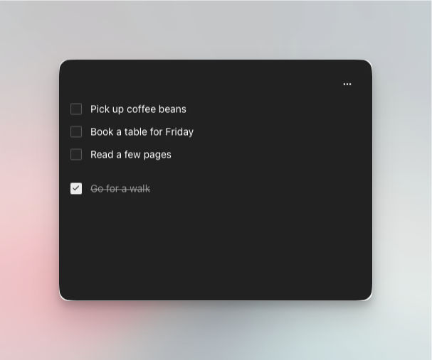
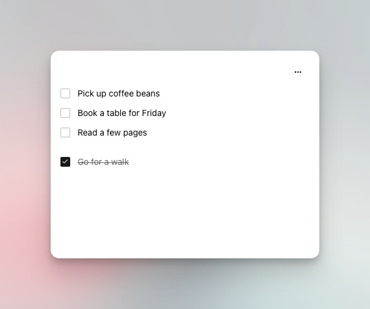

# Todos

A small checklist for Mac and iPhone. Double-tap the backtick key, write something down, get back to what you were doing.

<p align="center">
  
  
</p>

- Click beneath a task and type. Click away to save, or press Enter for the next row.
- Edit in place. Delete immediately. Command-Z brings it back.
- Checking or reopening a todo keeps it in place.
- Drag the quiet top strip to move the Mac window. Close and color controls appear on hover. The window stays on top and remembers its position and size.
- Command-W or Escape saves the draft and hides the window.
- Choose an accent for checkbox borders and fill, the text cursor, completed tasks, and delete icons. Typed text stays neutral; the checkmark contrasts with its fill. Colors are saved on each device; the phone widget follows its app.
- Light and charcoal themes, built with Sagar UI.
- Works locally without an account. Optional sync uses **your own Supabase project**.
- iOS app and interactive WidgetKit widget included. iOS 17+; device installation requires Xcode and signing.

Screenshots show the Mac app in an isolated demo session. Normal launches start empty. This is an early source release; iPhone installation and widget appearance still need device validation.

## Run on your Mac

Requires macOS 14+, Node 22.18+ and Swift from Xcode or Command Line Tools (`xcode-select --install`).

```sh
git clone https://github.com/Sagar-CK/todos.git
cd todos
npm ci
cp .env.example .env.local
npm run mac:build
mkdir -p ~/Applications
ditto build/Todos.app ~/Applications/Todos.app
open ~/Applications/Todos.app
```

The app runs independently of a development server. Quit Todos before replacing an existing installation; its data stays on the device.

For the global shortcut, enable **Todos** in **System Settings → Privacy & Security → Accessibility**. The app detects the permission automatically. Two unmodified presses of the physical backtick key show or hide the panel. A single backtick types after the double-tap interval (your system double-click interval, clamped to 0.3–0.6 seconds). Disable the shortcut from the menu if you need to type consecutive backticks normally. Secure input can suppress global shortcuts.

Local builds are ad-hoc signed. Rebuilding can invalidate the previous Accessibility grant; turn Todos off and back on, or remove and re-add `~/Applications/Todos.app`. Set `TODOS_SIGNING_IDENTITY` in the build environment to use your own signing identity.

## Set up your own sync

Every install is independent. There is no shared hosted backend, developer account, or personal project configuration in this repository.

1. Create a Supabase project. Run [`supabase/migrations/202610270001_todos.sql`](supabase/migrations/202610270001_todos.sql) in its SQL Editor. This creates the table, owner-only row-level security, timestamps, and Realtime publication. Alternatively, initialize/link the Supabase CLI and run `supabase db push`.
2. Edit `.env.local` with that project's URL and **publishable or legacy anon key**:

   ```dotenv
   VITE_SUPABASE_URL=https://YOUR_PROJECT_REF.supabase.co
   VITE_SUPABASE_ANON_KEY=YOUR_PUBLIC_CLIENT_KEY
   TODOS_BUNDLE_ID=com.yourname.todos
   TODOS_URL_SCHEME=mytodos
   TODOS_DEVELOPMENT_TEAM=
   ```

   Both Supabase fields may be empty for local use. Never put a service-role key, secret key, database password, or management token here. Public client keys ship in the app; row-level security protects the data. The build rejects service-role and secret keys.
3. In Supabase **Authentication → URL Configuration**, allow `mytodos://auth` (matching your chosen scheme). For the browser preview, also allow `http://127.0.0.1:5186` and `http://localhost:5186`. Set the Site URL to your browser origin if using the preview.
4. Keep the default magic-link email template. Supabase's default email sender only delivers to your project's organization members and has low rate limits. For other users, [configure custom SMTP](https://supabase.com/docs/guides/auth/auth-smtp).
5. Rebuild and install the Mac app. Build the iPhone app with the **same `.env.local` settings**. The sign-in prompt appears automatically on first launch. Enter the same email on each device and open the emailed link **on that device**. Sync then runs automatically, including retries after reconnecting. If you dismissed sign-in, reopen **Account…** from the Mac menu bar (or the phone’s options). Local tasks are imported when you sign in.

If you already use the Supabase CLI, `node scripts/configure-client.mjs YOUR_PROJECT_REF` fills the two backend fields without changing your native app identifiers. All personal configuration and generated client bundles are ignored by Git.

Choose your bundle ID before installing. Changing it creates a separate app identity and local data container. For a different backend, use a separate checkout and app identity rather than reusing a signed-in installation.

## Install on iPhone and add the widget

1. Install and open **Xcode**, including iOS platform support. Install XcodeGen with `brew install xcodegen`.
2. Set a unique `TODOS_BUNDLE_ID` in `.env.local`. Optionally set your ten-character `TODOS_DEVELOPMENT_TEAM`.
3. Run:

   ```sh
   npm run ios:prepare
   open native/ios/Todos.xcodeproj
   ```

4. Add your Apple account in Xcode settings. Select a development team for **both Todos and TodosWidget** under **Signing & Capabilities**. Both targets must use the generated App Group (`group.<your bundle ID>`) and shared Keychain group. Your team must support these capabilities; TestFlight distribution requires Apple Developer Program membership.
5. Connect and trust your iPhone. Enable [Developer Mode](https://developer.apple.com/documentation/xcode/enabling-developer-mode-on-a-device) when requested. Choose the phone as the destination and run the **Todos** scheme.
6. Sign in with the same email as on the Mac. Long-press the Home Screen, choose **Edit → Add Widget**, search for **Todos**, and add one. Tap a checkbox to complete a task.

The widget shares the phone app's session through Keychain and its cache through an App Group. It refreshes after app updates and widget actions, plus an iOS-managed timeline. A change on the Mac may take time to reach an idle widget. Widget checkbox actions require a network connection; the app queues offline changes for later.

## Develop

```sh
npm run dev           # Browser preview at http://127.0.0.1:5186
npm run mac:build     # Standalone AppKit + WKWebView app
npm run ios:prepare   # Generate configuration, embed UI, regenerate Xcode project
npm test             # Merge/outbox and configuration tests
```

Rerun `ios:prepare` after changing the UI or configuration. Generated files are not hand-edited. The Mac menu bar provides **Accent color…**, **Switch appearance**, and **Account…**. The small palette button appears in the window’s top-right corner only on hover.

`components/graphical/theme.ts` controls the web palette and the generated native widget colors.

To take screenshots without opening your real tasks:

```sh
open -n build/Todos.app --args --demo
```

Demo mode uses temporary storage, does not read or write your sign-in, does not sync, and does not register the global shortcut. Capture that window and use CleanShot's background tool; see [screenshot notes](docs/SCREENSHOTS.md).

CI checks the web build, unit tests, Mac compilation, and an unsigned iOS Simulator build. Live backend and browser integration tests are opt-in: [testing](docs/TESTING.md).

## Data and privacy

Tasks and a pending-operation outbox are saved locally before sync. Inserts are idempotent; edits update individual fields. Concurrent changes to the same field use server arrival order. Deletion is a tombstone, allowing session undo. Signed-in users can only access their own rows. Tokens are shared with native code through Keychain; the Supabase web client also persists its session in the app's local web storage.

No analytics or telemetry. The shortcut diagnostic at `~/Library/Logs/Todos/shortcut.json` records permission, listener and window flags, never keys typed, task text, or tokens.

[MIT license](LICENSE) · [Third-party notices](THIRD_PARTY_NOTICES.md)
